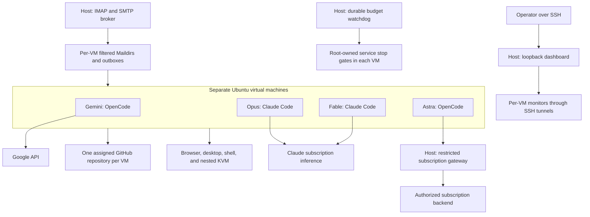

# Detailed experiment setup

This describes the infrastructure used for the September 2026 experiments and its final configuration. It distinguishes the private experimental phase from the later public publication phase. The examples use placeholders instead of the original host identity, account names, email addresses, addresses of private services, or credentials.

This is an architectural and operational reproduction guide, not an unattended installer. Cloud-init data, provider authentication, secrets, complete deployment automation, raw conversations, and VM images are not distributed here. Reproducing the exact outputs is not expected: model services, dependencies, internet research, and nondeterministic decisions can change.

## 1. Architecture



There are four separate VM instances, not four users or containers sharing one VM. The physical host owns orchestration, the mail account, the budget controller, and the dashboard proxy. A retired initial VM was kept as an operator-only archive and did not run a competing active agent.

## 2. VM resources and Linux accounts

Each final VM was provisioned with:

| Item | Configuration |
|---|---|
| Guest OS | Ubuntu Server 24.04 cloud image |
| vCPUs | 4 |
| RAM | 6 GiB |
| Disk | Thin qcow2, 240 GiB maximum virtual size |
| CPU mode | Host passthrough |
| Network | Libvirt NAT, virtio network adapter |
| Disk adapter | Virtio |
| VM console | Headless; no host graphical console required |
| Graphical application environment | Xvfb and Openbox inside the guest |
| Accounts | Separate administrator and unprivileged agent accounts |
| Startup | VM autostart and lingering systemd user services |

The disk size is a capacity limit, not 240 GiB of preallocated storage per guest. CPU, memory pressure and storage I/O on the shared physical host can still affect multiple VMs.

A representative host provisioning sequence is:

```sh
sudo apt install qemu-kvm libvirt-daemon-system virtinst cloud-image-utils qemu-utils

# Obtain and verify the Ubuntu 24.04 cloud image separately.
# Create distinct cloud-init user-data and meta-data for every VM.
cloud-localds seed.img user-data meta-data
qemu-img create -f qcow2 -F qcow2 -b /ABS/PATH/ubuntu-cloud.qcow2 guest.qcow2 240G

virt-install --connect qemu:///system \
  --name pdf-MODEL --memory 6144 --vcpus 4 --cpu host-passthrough \
  --import --os-variant ubuntu24.04 \
  --disk path=/ABS/PATH/guest.qcow2,bus=virtio \
  --disk path=/ABS/PATH/seed.img,device=cdrom \
  --network network=default,model=virtio \
  --graphics none --noautoconsole
virsh --connect qemu:///system autostart pdf-MODEL
```

The actual deployment uploaded independent sparse guest volumes into a libvirt storage pool. The backing-image command above is an illustrative equivalent; a backing image must remain available and immutable while dependent disks exist. Give libvirt permission to access the chosen storage paths.

Cloud-init installs the guest agent and required runtime/display packages, creates the two accounts, installs administrator-controlled firewall and power-management rules, and enables lingering for the agent:

```sh
sudo systemctl enable --now qemu-guest-agent
sudo usermod -aG kvm agent
sudo loginctl enable-linger agent
```

Nested virtualization must be enabled on the host and exposed to the guest. The deployment checked for `/dev/kvm` and tested a real nested QEMU launch; merely installing QEMU does not establish that nested acceleration works. Nested guests are intended for risky debugging, rather than modifying the physical host.

## 3. Isolation and privileges

During the clean experimental phase, each repository was private. Each VM received a separate fine-grained GitHub credential scoped to its own repository. Own-repository Git write access was verified, and the twelve cross-repository combinations returned denial/404. Private repository scope and VM network isolation were complementary controls.

Root-owned guest nftables rules permit public-network access, established replies and the required DNS traffic while rejecting connections to sibling guests and private/link-local networks. Astra has one additional narrowly scoped exception for the host subscription gateway. IPv6 is also restricted rather than left as an alternate route. Inbound administration is limited to the host's SSH path. Do not assume that libvirt NAT alone isolates guests from each other.

No shared agent home, workspace, broad GitHub SSH private key, or mailbox password is mounted in the four guests. Operator reset archives are root-only. The agent has no general sudo permission. Polkit denies the agent systemd/login1 power-management operations; VM lifecycle is controlled by the host administrator.

Agents can install normal user-space dependencies. After the package-helper change, they can also request Ubuntu packages:

```sh
agent-packages update
agent-packages install xdotool
```

This helper runs a root-owned, argument-validating wrapper around apt. It accepts `update` or `install` followed by package names from administrator-configured repositories, uses a fixed environment, and rejects arbitrary options, file paths and shell fragments. It does not grant a root shell or a shutdown command. The implementation was exercised as each agent account; arbitrary sudo commands remained denied.

On 8 October, the owner changed the publication policy. The repositories and Pages sites became public, and operational instructions were updated accordingly. **Repository-scoped tokens no longer prevent unauthenticated reading of other public projects.** Separate VMs still isolate local state, but a future comparison requiring source privacy must use new private repositories or an equivalent access boundary.

## 4. Runtimes and model configuration

Versions observed in the deployed fleet:

| Deployment | Runtime | Configured model | Effort |
|---|---|---|---|
| Gemini | OpenCode 1.18.32 | `google/gemini-3.8-flash` | Provider defaults; no matched explicit effort setting |
| Opus | Claude Code 2.1.284 | `claude-opus-5-5` | `medium` |
| Fable | Claude Code 2.1.284 | `claude-fable-5-1` | `medium` |
| Astra | OpenCode 1.18.32 | `openai/gpt-6-astra` | `medium`, also enforced by the gateway |

The shared tool installation used Node.js **24.21.0**. The guest Python runtime was **3.12.3**. These are deployment observations, not recommendations to use an unmaintained version indefinitely.

### OpenCode: Gemini and Astra

OpenCode runs as a loopback HTTP service in the assigned workspace. The user-level configuration contains:

- The assigned model and same-model auxiliary/small-model setting.
- An `OPERATIONS.md` instruction file and separate `mission.txt`.
- `permission: { "*": "allow", "question": "deny" }` for unattended work.
- Conversation sharing disabled and automatic runtime upgrades disabled.
- Browser and desktop MCP server definitions.
- A `forever.js` plugin implementing the recurring mission and mail wakeups.

A representative, incomplete configuration skeleton is:

```json
{
  "model": "PROVIDER/MODEL",
  "small_model": "PROVIDER/MODEL",
  "autoupdate": false,
  "permission": { "*": "allow", "question": "deny" },
  "share": "disabled",
  "instructions": ["/home/agent/.config/opencode/OPERATIONS.md"],
  "compaction": {
    "auto": true,
    "prune": true,
    "preserve_recent_tokens": 15000
  }
}
```

The omitted provider/model limits and `reserved` values matter: the target was auto-compaction around **500,000 context tokens**, not a universally valid `reserved` constant. Gemini used a 1,048,576-token context limit and 548,576 reserved tokens. Astra's configured 922,000-token input limit and 422,000 reserved tokens targeted the same threshold. The observed implementation used version-specific OpenCode compaction behavior; verify the trigger when porting this to another runtime version. Compaction is conversation summarization, not a reset of cost history.

Gemini authenticated through an API key held in its guest's private environment file. Astra pointed its OpenAI-compatible provider at a restricted host gateway; provider cost fields in that configuration were zero because the independent monitor, rather than OpenCode's built-in billing estimate, priced the subscription usage.

### Claude Code: Opus and Fable

Each native Claude runner is a Python user service with its own configuration directory, project memory, session ID, stream logs and SQLite ledger. The invocation was equivalent to:

```sh
claude -p \
  --output-format stream-json --verbose \
  --model claude-opus-5-5 --effort medium \
  --autocompact 500k \
  --dangerously-skip-permissions \
  --disallowedTools AskUserQuestion,EnterPlanMode \
  --strict-mcp-config --mcp-config /home/agent/.config/experiment/mcp.json \
  --settings /home/agent/.config/experiment/claude/settings.json \
  --append-system-prompt "$(cat /home/agent/.config/experiment/OPERATIONS.md)" \
  "$(cat /home/agent/.config/experiment/mission.txt)"
```

Fable substitutes its model identifier. Later turns add `--resume SESSION_ID`. Each VM uses its own `CLAUDE_CONFIG_DIR`. The runner records the session ID from the initialization event, saves verbose JSONL output, updates tool activity from result events, and persists token usage with deduplication. OAuth credentials were supplied through a private environment variable. Accounts/subscription access must be independently authorized; no tokens are included in this repository.

The allow-all tool mode is contained within the agent account's Linux privileges, guest firewall and external budget controls. It does not imply unrestricted host administration.

### Astra's host gateway

Astra's gateway retains subscription credentials on the host and gives the guest only a separate gateway credential. It admits the configured model, forces medium reasoning, serializes requests, checks provider availability and the external budget state, and has no paid-API fallback. Credential refresh is managed through the installed authorized client rather than by placing the host's refresh credentials in the VM.

Earlier experiments used a conservative daily percentage-of-weekly-subscription guard. That daily cutoff was superseded by the $100 lifetime rule for the final runs. Historical provisioning files may still contain the earlier percentage settings; they are not the final experiment's budget definition.

## 5. Mission, repetition and mail wakeups

The [mission template](../examples/mission.txt) is shared. Substitute only the assigned repository URL. Operational instructions identify the workspace, tools, mail commands, budget and publication rule without mentioning other deployments or previous implementations.

The final normal cadence is **five minutes after a completed turn**. It began at thirty minutes and was shortened during the clean run. The OpenCode plugin uses `FOREVER_INTERVAL_MS=300000`; native runners schedule `next_at = completion_time + 300000`. This is not a cron job that launches overlapping sessions every five minutes.

Conceptually:

```text
if permanently stopped or manually disabled: do not run
if a turn is active: wait
if provider/error backoff is active: wait
if unread relevant mail exists OR normal cooldown has expired:
    submit the mission to the existing session
    prepend a new-mail notice when appropriate
on successful completion:
    schedule the next ordinary turn five minutes later
```

Unread mail can bypass the ordinary cooldown, including mail left unread when a turn ends. It cannot override manual pause, provider/error backoff or the permanent budget stop. Mail arriving during an active turn waits for that turn to finish. The OpenCode plugin polls state on a five-second cadence; the native runner also checks periodically between turns.

The initial implementation reused a session across cycles. A clean reset is different from a pause/resume: it requires new conversation storage, empty workspace state and intentionally reset accounting, not just another mission submission in the same old session.

## 6. Mail service

A host-side broker polls an IMAP mailbox about once per minute and sends queued messages through SMTP. It holds the mailbox credentials; guests receive only local files.

Routing uses GitHub repository headers such as `List-Id` or `X-GitHub-Repository` ahead of subject matching. Direct mail can carry a model/repository subject tag. Unknown recipients are not broadcast to every agent. Reset cutoffs prevent old messages from being delivered to a new experiment.

Guest commands:

```sh
greatpdf-mail list
greatpdf-mail read MESSAGE_ID
greatpdf-send --to RECIPIENT --subject SUBJECT --body-file BODY_FILE
```

Reading moves/flags a Maildir message as seen; the broker propagates the seen state back to IMAP. Outgoing mail is queued locally, sent by the host and accompanied by a delivery receipt. Failed or uncertain sends are not automatically duplicated. Mail is treated as external input, not as authority to disclose credentials or override the mission.

The setup was tested for mail-driven wakeups during development. The final clean-run snapshot records zero messages received/read for each deployment, so these final runs do not measure comparative email-handling performance.

## 7. Browser and desktop use

Browser automation uses Playwright MCP with a locally installed Chromium executable and its own per-agent browser profile. The enabled capabilities include vision, PDF, and developer tools. Browser screenshots and artifacts stay in the agent's state directory. A typical launch is:

```sh
node /opt/agent-tools/computer-use/node_modules/@playwright/mcp/cli.js \
  --executable-path /opt/agent-tools/chromium/chrome-linux64/chrome \
  --caps vision,pdf,devtools --viewport-size 1280,720 \
  --user-data-dir /home/agent/.config/experiment/browser \
  --output-dir /home/agent/.local/state/experiment/browser \
  --allow-unrestricted-file-access
```

Desktop MCP controls the VM's Xvfb/Openbox display. It can take screenshots, move/click/drag, scroll, type, and send keys using `scrot` and `xdotool`. The display number must match the service and tool description. A screenshot-only smoke test does not prove input control works: the Opus incident exposed a missing `xdotool` executable, which was addressed by the package helper.

The Opus browser stall also demonstrated the importance of tool-call timeouts. In the installed Claude runtime, a silent stdio MCP tool call had a thirty-minute idle timeout. Progress/heartbeat display did not mean the browser action was advancing; the actual idle watchdog eventually returned an error. The agent then resumed by itself. These timeout semantics are runtime-version-specific and should be verified rather than assumed from the dashboard's “Working” label.

## 8. Cost accounting and the stop rule

The policy is **$100 per deployment**, not $100 shared across all four, and not a daily subscription percentage. Each monitor prices recorded usage; the host watchdog reads those totals approximately every five seconds.

The following coefficients were configured for the recorded September runs. They are a historical accounting specification, **not a claim about current provider prices**. Units are USD per million tokens.

| Model | Uncached input | Output | Cache read | Cache write |
|---|---:|---:|---:|---|
| Gemini 3.8 Flash | 0.75 | 3.75 | 0.075 | Counted at input rate |
| Opus 5.5 | 4.00 | 20.00 | 0.20 | 5.00 (5-minute), 8.00 (1-hour) |
| Fable 5.1 | 10.00 | 50.00 | 0.25 | 12.50 (5-minute), 20.00 (1-hour) |
| GPT-6 Astra | 10.00 | 50.00 | 1.00 | 12.50 |

For Astra requests above 272,000 input tokens, the monitor doubled input/cache rates and multiplied output rates by 1.5. It counted input plus cache reads/writes to select that tier. For OpenCode, the output quantity adds separately reported reasoning tokens. Native Claude accounting uses the reported `output_tokens` field and separate cache-creation duration categories. The Gemini monitor contained a date-dependent future rate adjustment, but the September measurements use the coefficients shown above.

A simplified native-Claude calculation is:

```text
USD = (input × input_rate
     + output × output_rate
     + cache_read × cache_read_rate
     + cache_write_5m × write_5m_rate
     + cache_write_1h × write_1h_rate) / 1,000,000
```

Usage is stored in SQLite and deduplicated by message identity. Claude updates keep maxima when the same identity is seen again; this avoids billing repeated stream events as separate responses. Cross-provider token semantics and the completeness of reported usage remain measurement limitations. Auxiliary/tool/provider charges and subscription invoices were not reconciled into a comprehensive financial bill.

The host owns a durable high-water mark and stop latch per deployment. Once a total reaches $100, it:

1. Persists the stop decision before attempting shutdown.
2. Writes a root-owned stop marker in the guest.
3. Installs a systemd unit condition that prevents the model service from starting while the marker exists.
4. Stops and disables that model service, disables automatic mission/mail dispatch, and rejects dashboard Resume.
5. Leaves monitoring and preview services available.

The marker is outside the agent's write authority. A service restart, new day, or lower guest ledger total does not clear the host latch. An operator must explicitly authorize and perform a new-budget reset. Missing/stale accounting for sixty seconds causes a fail-closed stop; Astra's request gateway also requires fresh budget data.

This is a polling/request-admission mechanism, not a mathematically exact charge ceiling. In-flight requests and delayed telemetry caused final overshoots from roughly $0.03 to $0.73. See the [results](experiments.md#final-clean-run-measurements).

## 9. Dashboard and private previews

The host dashboard binds to loopback, conventionally port 8787. Access it through an SSH forward:

```sh
ssh -N -L 8787:127.0.0.1:8787 operator@YOUR_HOST
# Open http://127.0.0.1:8787 on your computer.
```

Host-maintained SSH tunnels reach per-VM loopback monitors. The overview shows each model's status, cost, budget remaining, token counters, last activity, email counters and next wake time. Per-model details expose the full paginated activity history and controls. Cards link to source repositories, private local previews, and now public Pages sites. No provider or mailbox credentials are delivered to the browser.

Private preview services build copies of the workspace roughly every two minutes when files change. They adjust the deployment base in the copy, retain the last successful build if a rebuild fails, and serve it over a VM-loopback HTTP listener. The host proxy exposes `/preview/MODEL/` through the same dashboard connection. Preview builds can include unfinished local work; public Pages builds use committed `main` instead.

A few status fields need interpretation:

- A budget-stopped OpenCode server is offline by design; the dashboard can still retain its ledger and serve previews.
- Native Claude's monitor can be online while its agent is paused; use agent-enabled state and the host stop latch.
- An old `cooldown_minutes: 30` field remained in OpenCode monitor JSON even after the runtime interval changed to five minutes. The final interval was verified from runner code and `FOREVER_INTERVAL_MS`, not that stale display field.
- A tool marked “running” or emitting heartbeat events may be blocked rather than productive.

## 10. GitHub Pages publication

The owner authorized publication after the final agents had stopped. Every current and deprecated app has a `pages.yml` workflow, a repository-specific URL, and a `dist/` build artifact. The workflow uses GitHub's build/upload/deploy approach: [custom Pages workflows](https://docs.github.com/en/pages/getting-started-with-github-pages/using-custom-workflows-with-github-pages).

The build checks out committed code, sets up Node, runs `npm ci` and tests, and builds with:

```sh
npm run build -- --base="/REPOSITORY_NAME/"
```

It uploads the Pages artifact, then a separate job with `pages: write` and `id-token: write` deploys through the `github-pages` environment. Pushes to `main` and manual workflow dispatch trigger publication. The build job has read permissions; deployment does not require a long-lived personal token in the workflow.

A Vite base setting alone is insufficient when application code hard-codes `/pdfjs/`, `/cmaps/`, worker URLs, or logos at the organization-site root. Those references were corrected for the affected current applications. Deprecated apps retain their historical identity and have visible deprecation labels. Their published websites are archival comparisons, not resumed autonomous experiments.

## 11. Reset and validation procedure

For another clean run, explicitly separate reset authorization from an ordinary restart:

1. Stop model services and automatic mail dispatch. Archive source, conversations, memories, mail, browser profiles, usage and operator logs outside agent access.
2. Create independent empty workspaces and conversations. Preserve predecessor repositories separately if their history matters.
3. Remove old repository artifacts/Pages deployments if the new experiment requires source isolation. A force-push does not promise erasure of GitHub-retained unreachable objects or third-party copies.
4. Install the same mission with only the target substituted. Audit every injected instruction file, runtime append-prompt, MCP description and readable helper/monitor text for cross-run clues.
5. Verify scoped Git writes, cross-repository denials while private, sibling-network blocking, public internet access, `/dev/kvm`, browser navigation, screenshots and actual mouse/keyboard input.
6. Reset the accounting baseline only when authorized. Confirm dashboard spend/tokens/activity/mail are zero and the watchdog is live before starting models.
7. Verify each model produces new-session activity; record the exact configuration, software versions, start time and intervention log.

The final September run followed this reset pattern. Its model budgets are exhausted and its automatic maintainers are stopped. Republishing websites or updating this documentation does not restart those runs.
